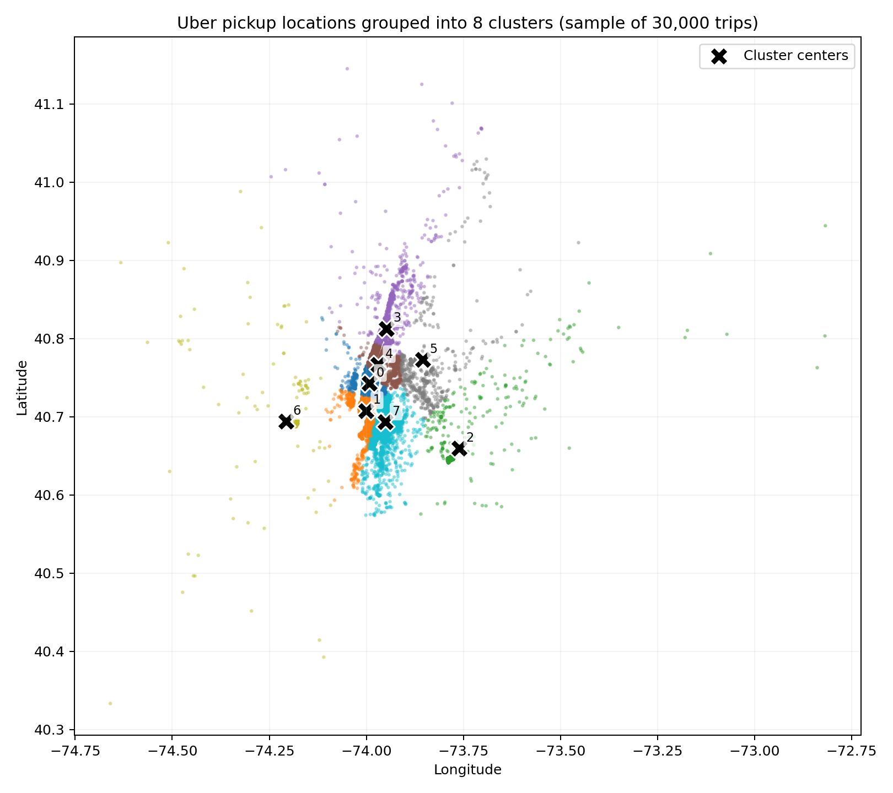
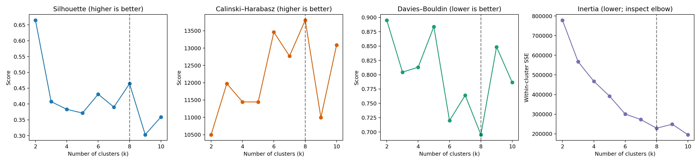
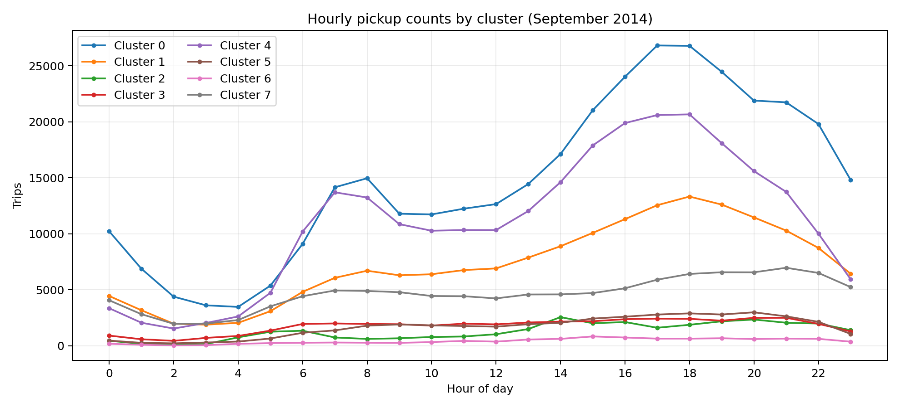
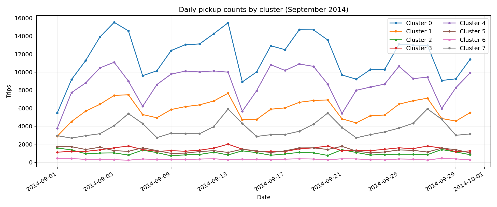
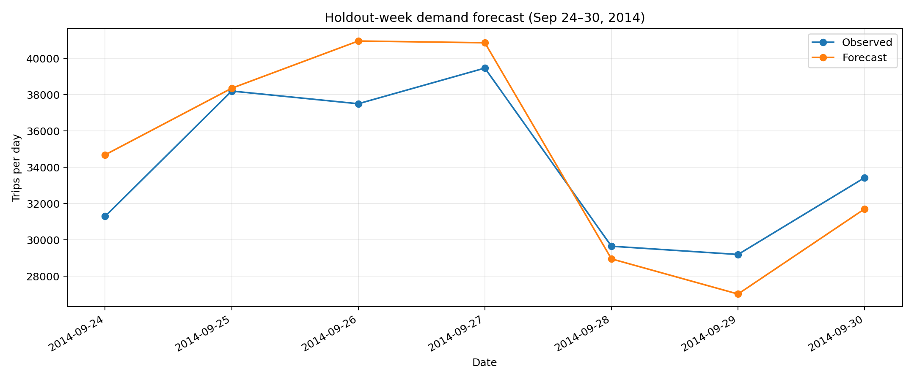

# Uber Pickup Clustering and Demand Forecasting

This project analyzes 1,028,136 Uber pickup records from New York City during September 2014. It groups pickup locations into geographic zones, compares cluster-quality measures, studies demand by hour and date, and forecasts hourly demand for the following week.

## Project contents

- `uber_rides_analysis.ipynb` — reviewable notebook with the workflow, key results, and charts.
- `analyze_uber_rides.py` — complete reproducible analysis pipeline.
- `cluster_quality_metrics.csv` — candidate-cluster diagnostics for k = 2–10.
- `cluster_centers.csv` — geographic centers and trip shares for the selected clusters.
- `forecast_metrics.csv` — holdout forecast errors by cluster.
- `forecast_october_1_to_7.csv` — hourly demand forecast for October 1–7, 2014.
- `figures/` — figures used in the report.

The original `uber-data.csv` is not committed because it is approximately 47 MB and was supplied separately for the assignment. Put it in the repository root before running the analysis.

## Questions addressed

1. Where are Uber pickups concentrated, and how can the locations be grouped?
2. How many clusters provide a useful geographic partition?
3. How does pickup demand in each zone vary by hour and by date?
4. Can historical demand patterns provide a useful short-term forecast?

## Method

The latitude and longitude values are converted to a local distance coordinate system in kilometres around New York City. `MiniBatchKMeans` is used because every trip can be assigned to a zone and the method scales to more than one million records. Candidate values from k = 2 to 10 are compared on a reproducible 25,000-trip sample. Silhouette and Calinski–Harabasz are maximized; Davies–Bouldin is minimized. The three rankings are combined to avoid choosing k from only one index. The final model is fitted to all trips.

The selected value is **k = 8**. Silhouette alone prefers k = 2, which gives a much coarser split; the combined ranking selects k = 8, which also has the best Calinski–Harabasz and Davies–Bouldin values among the tested candidates. This is a practical choice for comparing distinct demand zones, not a claim that one value is universally optimal.

For forecasting, each zone's demand is aggregated by hour. A weekday-and-hour historical mean is trained on September 1–23, then evaluated chronologically on September 24–30. The same profile, refitted to all of September, produces the October 1–7 forecast. This transparent benchmark fits the short time span; it should not be interpreted as a long-term forecast.

## Key findings

- The busiest pickup hour is **18:00**, with 75,040 trips during the month.
- The busiest date is **September 13**, with 43,205 trips.
- The eight clusters capture a range of scales: central Manhattan zones have the largest shares, while airport and outer-area clusters are smaller.
- On the final-week holdout, the overall WAPE is **14.53%**. Performance varies by zone, so the forecast should be read together with the per-cluster metrics.
- Exact duplicate rows are retained: the file has no trip identifier, so identical timestamp/location/base rows cannot safely be assumed to be duplicate rides.

## Main figures

### Geographic pickup clusters



### Cluster-selection diagnostics



### Hourly demand by zone



### Daily demand by zone



### Holdout forecast



## Run the analysis

1. Install the packages listed in `requirements.txt`.
2. Place the provided `uber-data.csv` file next to `analyze_uber_rides.py`.
3. Run:

   ```bash
   python analyze_uber_rides.py
   ```

The script writes figures, diagnostic tables, a summary JSON file, and the October forecast CSV into the project folder.

## Limitations

The data covers only one month, so the forecast can capture a basic weekly/hourly pattern but cannot model yearly seasonality, holidays, or long-term changes. The clustering quality measures are internal metrics computed from samples; they quantify geometric separation, not whether the zones perfectly match official neighbourhood boundaries. Cluster labels are arbitrary identifiers.
