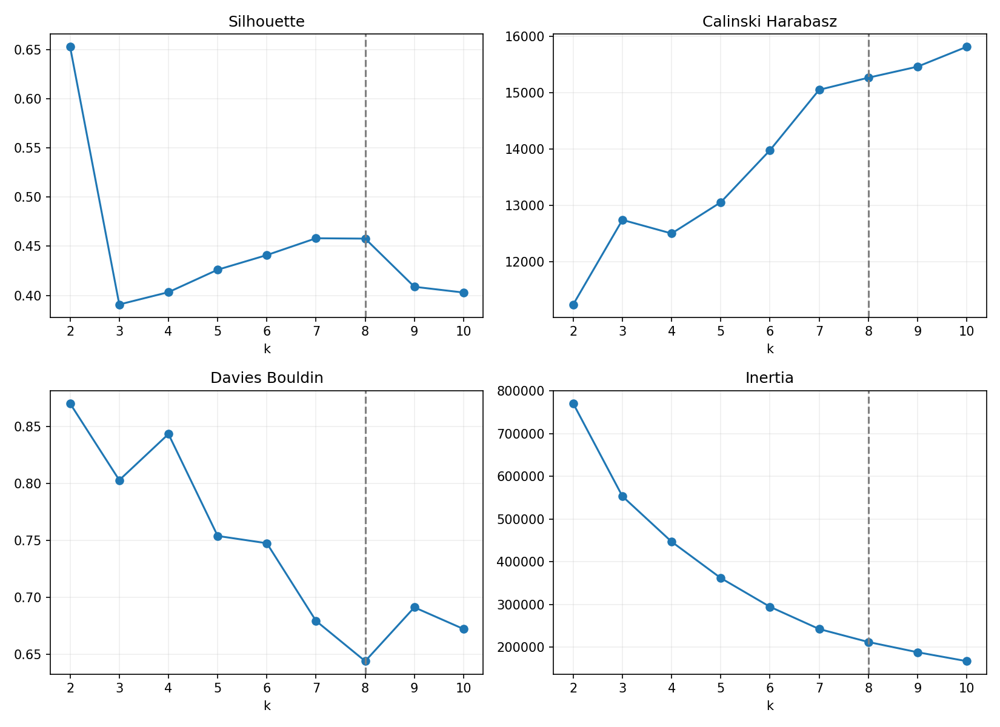
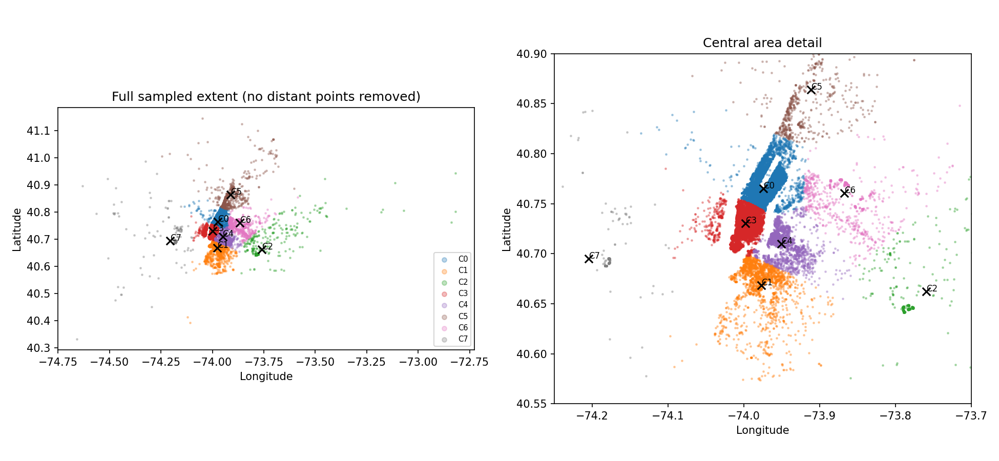
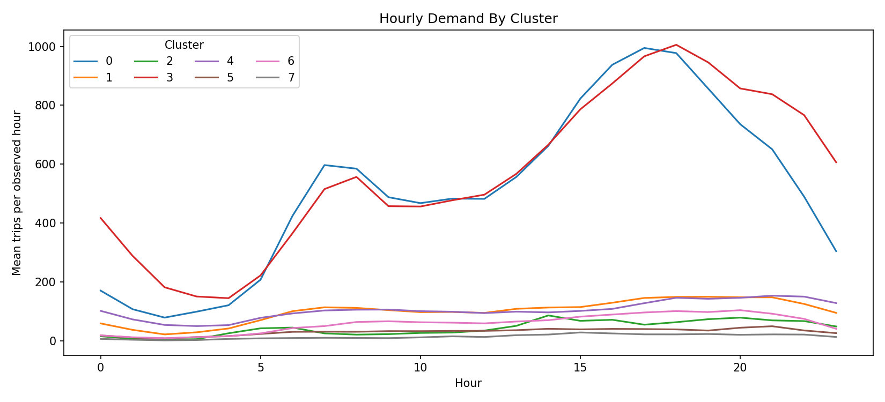
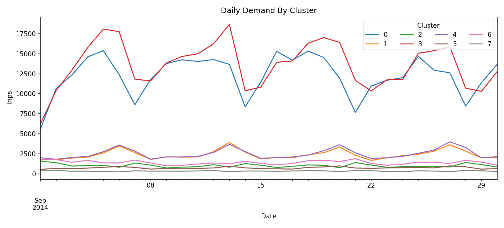
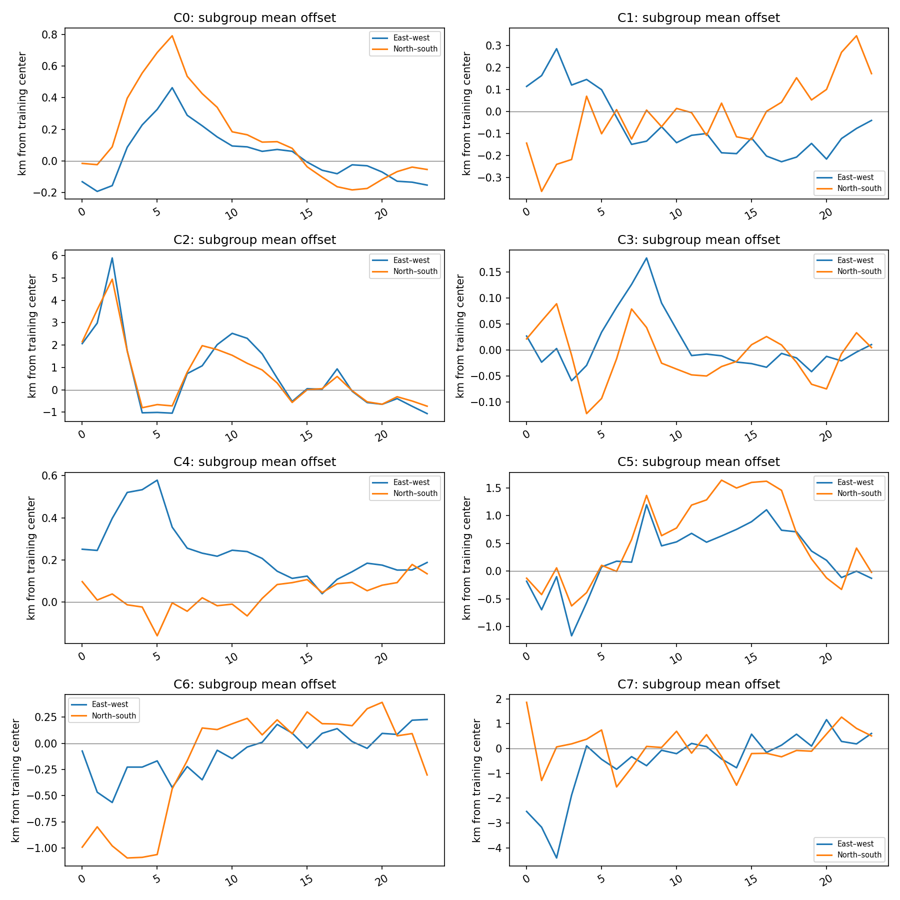
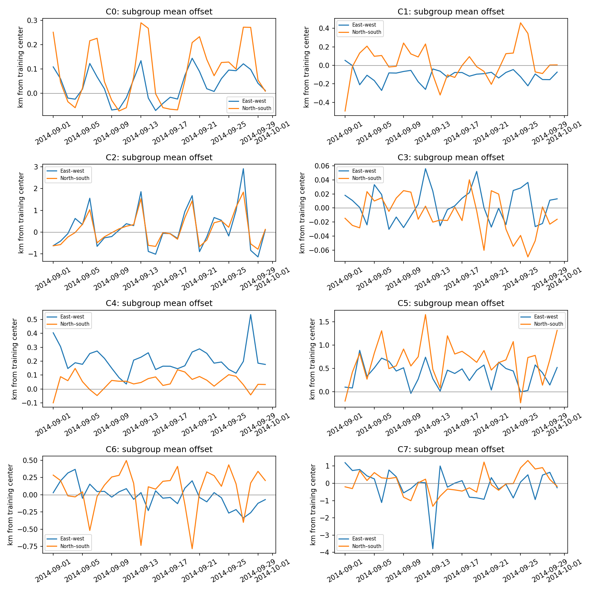
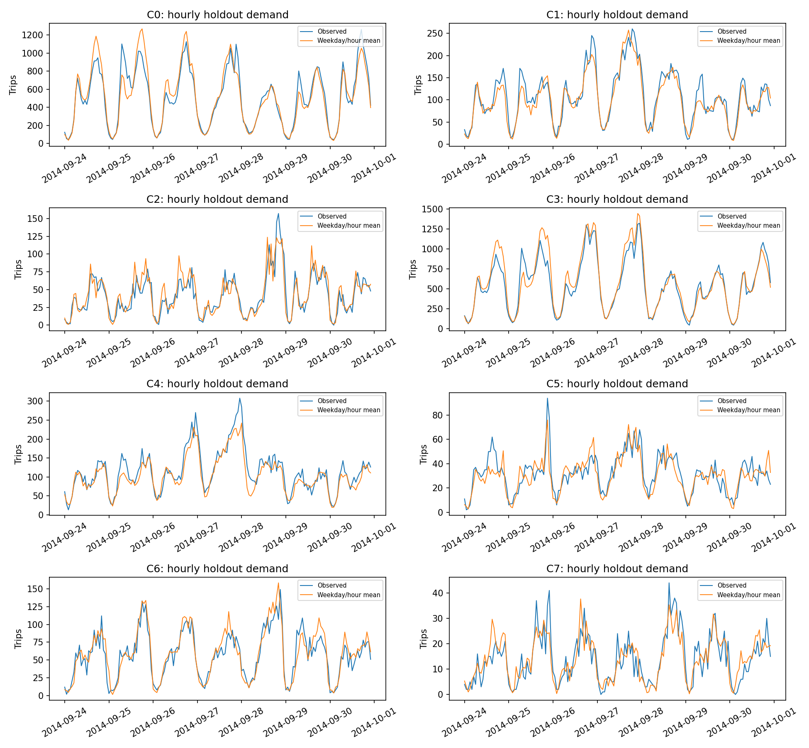

# Uber pickup clustering and forecasting

## Interpretation and limitations

### Algorithm and cluster count
K-means creates compact distance-based zones and assigns every pickup to a zone, making fixed-zone forecasting straightforward. MiniBatch K-means scales the final fit to the training records. DBSCAN could identify irregular density regions and noise, but density parameters and unassigned noise complicate exhaustive zone-demand forecasts; it was not empirically benchmarked here. Hierarchical and spectral methods require additional sampling or approximations at this scale.

Candidates k=2–10 were fitted with 10 K-means starts on a 25,000-record **training-only** sample. Silhouette uses 4,000 of those points; CH and DB use the full sample. Equal-weight rank aggregation selects **k=8**. The three indices are related internal measures, not independent votes, and rank aggregation is a heuristic, not proof of a globally optimal partition. The highest silhouette occurs at k=2. Candidate metrics and final MiniBatch model metrics are reported separately.

### Location and demand differences
| cluster | center_lat | center_lon | trips | share_pct |
|---|---|---|---|---|
| 0 | 40.765 | -73.974 | 368560 | 35.847 |
| 1 | 40.668 | -73.977 | 71889 | 6.992 |
| 2 | 40.662 | -73.759 | 30812 | 2.997 |
| 3 | 40.730 | -73.998 | 407548 | 39.639 |
| 4 | 40.710 | -73.950 | 75044 | 7.299 |
| 5 | 40.864 | -73.911 | 21969 | 2.137 |
| 6 | 40.761 | -73.868 | 42176 | 4.102 |
| 7 | 40.695 | -74.204 | 10138 | 0.986 |

Cluster numbers are identifiers, not a ranking. Centers give approximate geographic locations; zones need not match administrative boundaries. All valid-coordinate trips, including distant points, remain in the analysis. K-means and subgroup averages can be influenced by those distant trips.

| cluster | peak_hour | peak_date | max_hour_center_offset_km | max_date_center_offset_km | min_hour_group_n | min_date_group_n |
|---|---|---|---|---|---|---|
| 0 | 17 | 2014-09-05 | 0.917 | 0.319 | 2357 | 5602 |
| 1 | 19 | 2014-09-13 | 0.399 | 0.497 | 645 | 1677 |
| 2 | 14 | 2014-09-01 | 7.691 | 3.442 | 112 | 725 |
| 3 | 18 | 2014-09-13 | 0.183 | 0.078 | 4337 | 6233 |
| 4 | 21 | 2014-09-27 | 0.600 | 0.537 | 1494 | 1811 |
| 5 | 21 | 2014-09-27 | 1.962 | 1.811 | 232 | 560 |
| 6 | 20 | 2014-09-21 | 1.131 | 0.809 | 261 | 1001 |
| 7 | 15 | 2014-09-01 | 4.403 | 4.017 | 37 | 233 |

- C0 accounts for 35.85% of pickups. Its exposure-adjusted hourly peak is 17:00 and its highest recorded daily count occurs on 2014-09-05. The largest hourly subgroup-center offset is 0.92 km; the largest daily offset is 0.32 km.
- C1 accounts for 6.99% of pickups. Its exposure-adjusted hourly peak is 19:00 and its highest recorded daily count occurs on 2014-09-13. The largest hourly subgroup-center offset is 0.40 km; the largest daily offset is 0.50 km.
- C2 accounts for 3.00% of pickups. Its exposure-adjusted hourly peak is 14:00 and its highest recorded daily count occurs on 2014-09-01. The largest hourly subgroup-center offset is 7.69 km; the largest daily offset is 3.44 km.
- C3 accounts for 39.64% of pickups. Its exposure-adjusted hourly peak is 18:00 and its highest recorded daily count occurs on 2014-09-13. The largest hourly subgroup-center offset is 0.18 km; the largest daily offset is 0.08 km.
- C4 accounts for 7.30% of pickups. Its exposure-adjusted hourly peak is 21:00 and its highest recorded daily count occurs on 2014-09-27. The largest hourly subgroup-center offset is 0.60 km; the largest daily offset is 0.54 km.
- C5 accounts for 2.14% of pickups. Its exposure-adjusted hourly peak is 21:00 and its highest recorded daily count occurs on 2014-09-27. The largest hourly subgroup-center offset is 1.96 km; the largest daily offset is 1.81 km.
- C6 accounts for 4.10% of pickups. Its exposure-adjusted hourly peak is 20:00 and its highest recorded daily count occurs on 2014-09-21. The largest hourly subgroup-center offset is 1.13 km; the largest daily offset is 0.81 km.
- C7 accounts for 0.99% of pickups. Its exposure-adjusted hourly peak is 15:00 and its highest recorded daily count occurs on 2014-09-01. The largest hourly subgroup-center offset is 4.40 km; the largest daily offset is 4.02 km.

### What “center changes” means
The trained model centers stay fixed. For each zone, the report separately calculates the average pickup latitude/longitude by hour of day (pooled over the month) and by calendar date. Offset plots show those empirical subgroup means relative to the fixed training center. Thus they measure changing pickup composition **within a zone**, not a refitted cluster or a moving vehicle. Among these zones, C3 has the smallest maximum daily offset (0.08 km), while C7 has the largest (4.02 km). Counts accompany every center estimate; small groups and outliers can amplify shifts, so these differences are descriptive rather than significance tests.

September 30 ends at 22:59 in the file. Its 23:00 bin is unobserved and excluded, not filled with zero. Daily totals for September 30 cover only 23 observed hours; hourly profiles divide by observed exposure (29 observations of hour 23, 30 of the other hours).

### Forecast results
The weekday/hour mean was specified before evaluating the holdout. It achieves **14.64% WAPE**, versus **16.30%** for using the same hour one week earlier. ALL-row MAE/RMSE average zone-hour errors; ALL WAPE sums absolute zone-hour errors divided by all test trips, so it is not the error of aggregated citywide totals. Neither model uses holdout demand to generate holdout predictions. K selection and geographic centers also exclude the holdout.

For October 1–7, demand profiles are refitted on all observed September demand while the geographic zone definitions stay fixed. No October actual outcomes are supplied, so those future forecasts cannot be verified here. One month and one holdout week limit generalization; events, weather, long-term trends, and annual seasonality are absent. This is an interpretable baseline, not a claim of optimal predictive performance.

